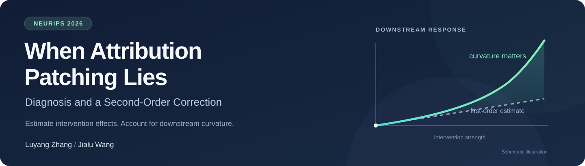
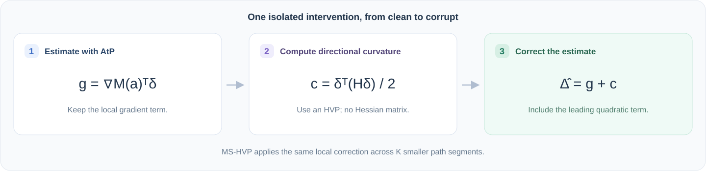
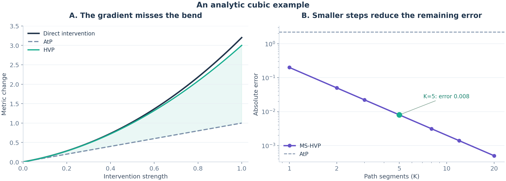

<div align="center">



# When Attribution Patching Lies

### Diagnosis and a Second-Order Correction

**[Luyang Zhang](https://scholar.google.com/citations?user=lIDmS7oAAAAJ&hl=en) · [Jialu Wang](https://scholar.google.com/citations?user=HOtDeN0AAAAJ&hl=en)**<br>
**NeurIPS 2026**

[](https://arxiv.org/abs/2606.09899)
[](https://arxiv.org/abs/2606.09899)
[](pyproject.toml)
[](https://github.com/LZhang12345/attribution-patching-lies/actions/workflows/tests.yml)
[](LICENSE)

[Paper](https://arxiv.org/abs/2606.09899) · [Quick start](#quick-start) · [Method](#how-it-works) · [Model example](#try-it-on-attention-heads) · [Documentation](docs/method.md) · [Citation](#citation)

</div>

**Attribution patching estimates an intervention with a straight line. The downstream network can bend that line.** We analyze this approximation error and add its leading quadratic term using a Hessian-vector product (HVP). Multi-step HVP (MS-HVP) repeats the correction along the activation path when a single local expansion is insufficient.

This repository provides the core methods from our paper, a model-independent PyTorch API, attention-head examples, and the isolated-edge scoring utilities used in our MIB experiments. The paper evaluates models from 124M to 9B parameters.

<p align="center">
  
</p>

## Quick start

Python 3.10 or later is required. The core package needs only PyTorch.

```bash
git clone https://github.com/LZhang12345/attribution-patching-lies.git
cd attribution-patching-lies
python -m venv .venv
source .venv/bin/activate
python -m pip install -e .
python -m hvp_patching demo
```

The demo runs on CPU, downloads no model, and evaluates a cubic with a known answer:

```text
Activation patching     3.2000
Attribution patching    1.0000
HVP                     3.0000
MS-HVP, K=5             3.1920
IG, midpoint S=10       3.1995
```

The figure below is generated by the released code. It illustrates how the correction removes quadratic error and how higher-order error decreases with additional steps. These are analytic example values, not language-model benchmark results.

<p align="center">
  
</p>

## Use the methods in your code

Supply a differentiable function that reruns the downstream computation with one component's activation set to `a`:

```python
import torch
from hvp_patching import activation_patching, hvp, multi_step_hvp

def metric_fn(a):
    # Replace with the downstream model computation and your scalar metric.
    return (a + 2 * a.square() + 0.2 * a.pow(3)).sum()

clean = torch.zeros(1, dtype=torch.float64)
corrupt = torch.ones_like(clean)

result = hvp(metric_fn, clean, corrupt)
print(result.atp)         # first-order term
print(result.correction)  # leading quadratic term
print(result.estimate)    # their sum

ms = multi_step_hvp(metric_fn, clean, corrupt, steps=5)
reference = activation_patching(metric_fn, clean, corrupt)
```

`metric_fn` returns a scalar tensor. Endpoints use float32 or float64. The direction is **corrupt minus clean**, the expansion starts at **clean**, and all estimates describe the **patched-minus-clean** metric change.

## How it works

For a fixed isolated intervention, let $\delta=a_{\mathrm{corrupt}}-a_{\mathrm{clean}}$. Attribution patching keeps the first-order term of the downstream metric $M$:

$$
\widehat\Delta_{\mathrm{AtP}}=\nabla M(a_{\mathrm{clean}})^\top\delta.
$$

HVP adds the leading quadratic term without forming a Hessian:

$$
\widehat\Delta_{\mathrm{HVP}}=
\widehat\Delta_{\mathrm{AtP}}
+\frac12\delta^\top\bigl(H(a_{\mathrm{clean}})\delta\bigr).
$$

MS-HVP divides the same path into $K$ segments and sums a local gradient term and quadratic correction on each segment. The method needs gradients and HVPs; a smoothness constant is needed only for the theoretical remainder guarantee.

| Method | Local information | Computation for one isolated intervention |
| :--- | :--- | :--- |
| AtP | Gradient at the clean endpoint | One gradient evaluation |
| HVP | Gradient and directional curvature | One gradient evaluation plus one HVP |
| MS-HVP | Gradient and directional curvature at each path segment | $K$ gradient evaluations and $K$ HVPs |
| IG reference | Gradients along the same path | $S$ gradient evaluations; midpoint quadrature |
| Activation patching | Direct endpoint evaluation | Clean and patched forward evaluations |

This table counts derivative queries, not wall-clock speedups. Correcting multiple isolated components requires their separate directional corrections. Gradients at a shared base point can be reused by a specialized runner. See [the method notes](docs/method.md) for the exposure diagnostic, zero denominators, and the MS-HVP guarantee.

## Try it on attention heads

Install the model extra and exercise the hooks on a small, randomly initialized GPT-2. This also runs entirely on CPU without downloading weights:

```bash
python -m pip install -e '.[models]'
python examples/tiny_transformer.py
```

For a pretrained model, this command evaluates the two included illustrative IOI prompt pairs:

```bash
python -m hvp_patching heads \
  --model gpt2 \
  --pairs examples/ioi_pairs.jsonl \
  --heads 8:6,9:9 \
  --steps 5 \
  --ig-steps 10 \
  --device cpu \
  --output outputs/gpt2_heads.json
```

Use `--device cuda` for a GPU and `--revision <commit>` to fix a model revision. The adapter uses eager attention for second derivatives. It checks each coordinate endpoint against an independent direct head replacement and records model revision, metric, intervention direction, library versions, raw scores, and absolute errors.

The included pairs demonstrate the interface; they are not the paper's full evaluation cohorts. See [reproduction and MIB](docs/reproduction.md) for the released scope, split conventions, and the distinction between component-level IG and MIB's EAP-IG.

## Repository guide

| Path | Contents |
| :--- | :--- |
| [`src/hvp_patching/estimators.py`](src/hvp_patching/estimators.py) | AtP, HVP, MS-HVP, direct activation patching, and an IG reference |
| [`src/hvp_patching/heads.py`](src/hvp_patching/heads.py) | Attention-head hooks for GPT-2 and Llama-style projection layouts |
| [`src/hvp_patching/benchmark.py`](src/hvp_patching/benchmark.py) | Prompt-pair benchmark runner and endpoint validation |
| [`src/hvp_patching/mib.py`](src/hvp_patching/mib.py) | Original isolated-edge scoring core, work units, and record validation |
| [`examples/`](examples/) | A model example and illustrative prompt pairs |
| [`tests/`](tests/) | Analytic derivative tests and miniature decoder integration tests |
| [`docs/`](docs/) | Method details, reproduction scope, and implementation provenance |
| [`scripts/build_readme_assets.py`](scripts/build_readme_assets.py) | Regenerates the analytic example plot and values |

## Development

```bash
python -m pip install -e '.[dev,models,plots]'
python -m pytest -q
ruff check .
python scripts/build_readme_assets.py
```

The tests check the quadratic correction, the cubic $1/K^2$ remainder, the direction convention, isolated versus joint interventions, zero-denominator behavior, and independent head-replacement endpoints. CI runs the CPU tests on Python 3.10 and 3.12.

## Citation

If this code is useful in your work, please cite our paper:

```bibtex
@inproceedings{zhang2026attribution,
  title     = {When Attribution Patching Lies: Diagnosis and a Second-Order Correction},
  author    = {Zhang, Luyang and Wang, Jialu},
  booktitle = {Advances in Neural Information Processing Systems},
  year      = {2026},
  url       = {https://arxiv.org/abs/2606.09899}
}
```

## Acknowledgments and license

We thank the authors of [MIB](https://github.com/aaronmueller/MIB), [TransformerLens](https://github.com/TransformerLensOrg/TransformerLens), [Transformers](https://github.com/huggingface/transformers), and [PyTorch](https://github.com/pytorch/pytorch) for their open research tools. The reference code and original illustrations in this repository are released under the [MIT license](LICENSE). External model weights, datasets, and benchmark implementations retain their respective licenses.
